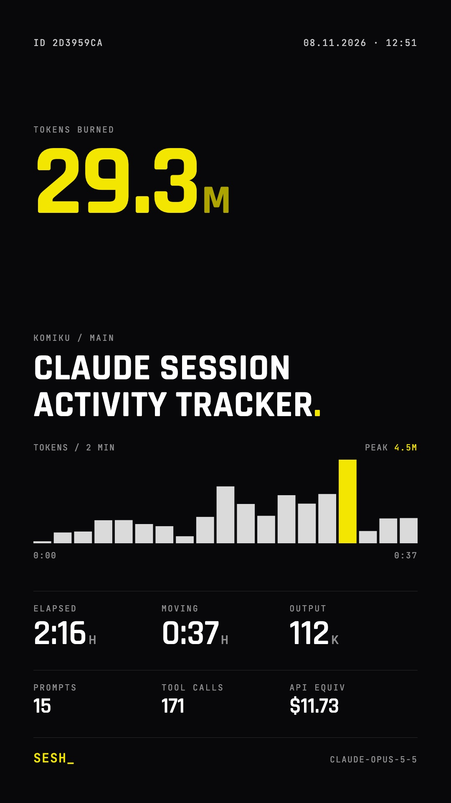

<div align="center">

&nbsp;&nbsp;&nbsp;

# `SESH_`

**One session. One card. Straight to your story.**

`sesh` reads the transcript of a single Claude Code or Codex session and renders it as a 1080×1920 story card: tokens burned, moving time, output, prompts, tool calls and a token-pace chart.

`CLAUDE CODE` · `CODEX` · `NODE 18+` · `ZERO DEPENDENCIES` · `MIT`

</div>

---

## `> BOOT`

```text
> /sesh:sesh   [image attached]

sesh  Claude session activity tracker
      29.3M tokens · 0:37 moving · 15 prompts · 171 tool calls · $11.73 API equiv · claude-opus-5-5
card  ~/sesh/20261108-2d3959ca.png
```

- **One session, not your lifetime total.** The card covers the session you are in, like a single run.
- **Local only.** Stats come from the transcript files already on your machine. Nothing is uploaded.
- **Real numbers.** Every value on the card is computed from the transcript. No estimates, no filler.
- **Optional photo.** Add your own background, or ship the plain card with the token count as the hero.

## `> INSTALL`

### Claude Code

```bash
claude plugin marketplace add Adefebrian/sesh
claude plugin install sesh@sesh
```

Or inside a session: `/plugin marketplace add Adefebrian/sesh`, then `/plugin install sesh@sesh`.

### Codex

```bash
codex plugin marketplace add Adefebrian/sesh
codex plugin add sesh@sesh
```

The plugin ships a `sesh` skill. Ask Codex to "sesh this session" or "make a story card of this session".

### Standalone CLI

```bash
npx github:Adefebrian/sesh --help
```

### Requirements

| Need | Why |
|---|---|
| Node.js 18 or newer | runs the parser and renderer |
| Chrome, Chromium, Edge or Brave | renders the PNG in headless mode |

If no browser is found, `sesh` saves the card as HTML and tells you. Point it at any Chromium-based binary with `SESH_BROWSER=/path/to/chrome`.

## `> RUN`

Type the command. Attach a photo if you want one. That is it.

| Agent | Do this |
|---|---|
| Claude Code | type `/sesh:sesh`, optionally attach or paste an image in the same message |
| Codex | ask *"sesh this session"*, optionally with an image attached |

- **With an image:** it becomes the card background.
- **Without one:** you get the plain dark card with the token count as the hero.
- The PNG is saved to `~/sesh/` and shown in the chat.

<details>
<summary>Terminal and advanced flags</summary>

```bash
npx github:Adefebrian/sesh --agent claude
```

| Flag | Default | Description |
|---|---|---|
| `--agent <claude\|codex>` | auto | Which transcript to read |
| `--session <id\|path>` | current session | A session id or a `.jsonl` transcript path |
| `--photo <path>` | attached image | Background photo file: jpg, png or webp |
| `--no-photo` | off | Ignore an attached image |
| `--out <file.png>` | `~/sesh/<date>-<id>.png` | Where to write the card |
| `--cwd <dir>` | current directory | Project folder to look up |
| `--html` | off | Keep the HTML next to the PNG |
| `--json` | off | Print parsed stats as JSON and exit |

</details>

## `> TELEMETRY`

What lands on the card and where it comes from.

| Field | Meaning | Claude Code source | Codex source |
|---|---|---|---|
| **Tokens** | input + output + cache read + cache write, subagents included | `message.usage`, once per API response, plus `<session>/subagents/*.jsonl` | last `token_count.total_token_usage` of the session and every subagent thread it spawned |
| **Moving** | active time; gaps over 5 min count as idle | line timestamps | line timestamps |
| **Elapsed** | first to last event (plain card only) | line timestamps | line timestamps |
| **Output** | tokens the model wrote | `usage.output_tokens` | `output_tokens` |
| **Prompts** | messages you typed, slash commands included, `/sesh` excluded | main transcript only; subagent instructions are not counted | `user_message` events, else real user messages |
| **Tool calls** | every tool invocation, subagents included | `tool_use` blocks | `function_call` items |
| **API equiv** | what the session would cost at standard API list prices; `—` when the model has no published price, `+` when only part of it does | each response priced on its own model: input, output, cache read, 5m and 1h cache writes, fast mode, Haiku 5.5 long-prompt tier | each request priced from `last_token_usage`: input, cached input, cache writes, output, long-context tier |
| **Chart** | tokens per bucket over moving time, peak in yellow | per response | per `token_count` delta |
| **Title** | session title, else your first prompt | `custom-title` / `summary` | thread name / first prompt |

Transcripts are read from `~/.claude/projects/` and `~/.codex/sessions/`.

### About API equiv

Most people run Claude Code and Codex on a subscription, not pay-per-token. **API equiv** answers a different question: what this session would have cost at standard API list prices. Prices come from the official pricing pages, are stored in [`pricing.mjs`](skills/sesh/scripts/pricing.mjs) with the date they were checked, and exclude batch discounts, data residency uplifts and taxes. Models routed through a third-party provider or proxy are shown as `—` rather than guessed.

### Which session

- **Claude Code:** `/sesh` passes the id of the session you are in, so a second session running in the same folder is never picked by mistake.
- **Codex:** the newest top-level session started in the current folder. Subagent threads are never picked on their own; their work is rolled into the session that spawned them.
- **Anywhere:** `--session <id|path>` picks one explicitly.

## `> ANATOMY`

```text
sesh/
├── .claude-plugin/        Claude Code plugin + marketplace manifest
├── .codex-plugin/         Codex plugin manifest
├── commands/sesh.md       /sesh slash command (Claude Code)
├── skills/sesh/
│   ├── SKILL.md           shared skill for Claude Code and Codex
│   └── scripts/
│       ├── sesh.mjs       CLI entry
│       ├── parse.mjs      Claude Code + Codex transcript parsers
│       └── card.mjs       1080×1920 card template
└── bin/sesh.mjs           npx entry
```

## `> PRIVACY`

The card shows the project folder name, git branch, session title and model. Check the card before you post it if any of those are private. Use `--session` to pick a different session or edit the title in your agent before rendering.

## `> LICENSE`

MIT © Ade Febrian.

<div align="center"><sub><code>SESH_</code> · end of transmission</sub></div>
